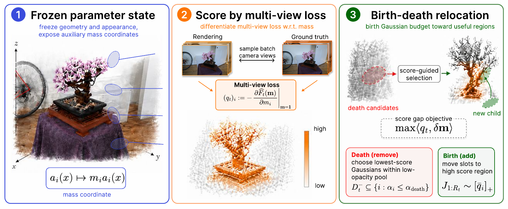

# Birth-Death Structural Learning for 3D Gaussian Splatting

**Quan Tran Hong, Long Nguyen-Chi, and Binh T. Nguyen**

Center for AI Research, VinUniversity

We guide Gaussian densification with a first-variation score from the multi-view
reconstruction loss. This repository implements the **Vanilla 3DGS adaptation**.



*Paper overview with the MCMC backend. This code uses Vanilla cloning and splitting.*

## Method

At each density-control step, we freeze the scene and attach a temporary mass
variable to each Gaussian's opacity. Differentiating the image loss gives:

$$
q_i = -\left.\frac{\partial \widehat F(m)}{\partial m_i}\right|_{m=1}
    = -\alpha_i\frac{\partial \widehat F}{\partial \alpha_i}.
$$

A positive score means that increasing the Gaussian's contribution would
locally reduce the loss. We use this score to select parents for Vanilla
cloning and splitting, retaining opacity and size pruning.

## Install

Requires Linux, an NVIDIA GPU, Python 3.11, and the CUDA 12.8 toolkit (`nvcc`).
Setup installs PyTorch 2.11.0 and builds the CUDA extensions.

```bash
git clone --recurse-submodules https://github.com/quanth238/birth-death-3dgs.git
cd birth-death-3dgs
python3.11 -m venv .venv
source .venv/bin/activate
bash scripts/setup.sh
```

## Train and evaluate

Prepare a COLMAP scene with `images/` and `sparse/0/`, following the
[3DGS dataset format](https://github.com/graphdeco-inria/gaussian-splatting#running).
[Mip-NeRF360](https://jonbarron.info/mipnerf360/) provides the scenes used below.

```bash
# First variation: 7k training, held-out rendering, and metrics
bash scripts/train_eval.sh /path/to/bicycle output/bicycle_fv

# Matched Vanilla baseline
bash scripts/train_eval.sh /path/to/bicycle output/bicycle_vanilla vanilla
```

The optional third and fourth arguments are the method (`fv` or `vanilla`) and
iteration count (default: `7000`). Metrics are saved to `results.json` and
`per_view.json` in the model directory.

## Results

Mean results on all nine Mip-NeRF360 scenes at **7k iterations**:

| Method | PSNR ↑ | SSIM ↑ | LPIPS ↓ | Mean Gaussians ↓ |
|---|---:|---:|---:|---:|
| Vanilla 3DGS | 26.0086 | 0.7683 | 0.2845 | 2,038,866 |
| First-variation ADC | **26.3471** | **0.7864** | **0.2558** | **1,736,970** |

Gaussian counts vary by scene. See [per-scene results and protocol](docs/results.md).

## Citation and license

```bibtex
@misc{tran2026birthdeath,
  title={Birth-Death Structural Learning for 3D Gaussian Splatting},
  author={Tran Hong, Quan and Nguyen-Chi, Long and Nguyen, Binh T.},
  year={2026}
}
```

Built on [3D Gaussian Splatting](https://github.com/graphdeco-inria/gaussian-splatting).
The upstream [license](LICENSE.md) restricts use to research and noncommercial
evaluation. See [third-party notices](THIRD_PARTY_NOTICES.md) for attribution.
